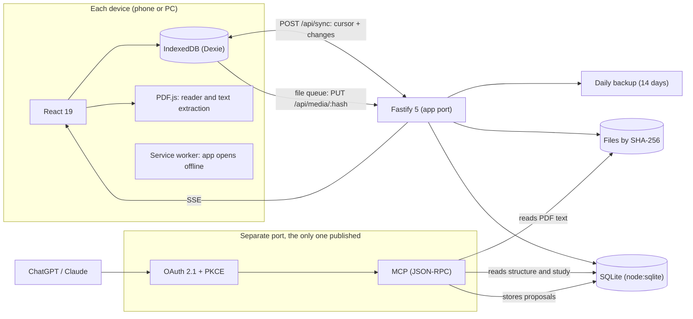

# LIFE RPG architecture

[Português](ARCHITECTURE.md) · [README](README.en.md)

This document explains how LIFE RPG stores, syncs and exposes data, and why each decision was made. The app has a single
user, but it runs on more than one device (phone and PC) and talks to outside AI assistants, so the problems are those
of a small distributed system: devices without internet, conflicts, large files and a clear boundary of what may leave
home.

## Overview

The code is a TypeScript monorepo:

- `packages/shared`: the domain rules, with no browser or server dependency;
- `apps/web`: the PWA (screens, local database, sync, PDF reader);
- `apps/server`: the API (sync, files, backups, notifications and the assistants' connector).

## 1. Data on the device first, and sync

- **Every write goes to IndexedDB first.** The UI never waits for the network and the app works with the server off.
  Every record carries `updatedAt` and `deleted` (soft delete), and every write goes through a single module
  (`repo.ts`) that maintains those fields.
- **Cursor-based sync.** The server keeps a global revision number. Each round sends the device's changes and receives
  everything changed since its cursor. A round runs when the app opens, when it comes back to the foreground, every
  minute and when the network returns.
- **Conflicts: the latest change wins** (record-level last-write-wins). It is simple and enough for one person, but a
  frequent write could undo a change made on another device. That is why high-frequency data lives in its own records:
  the page where I stopped in a PDF is kept in a progress record separate from the PDF record, so reading on the phone
  never undoes a subject change made on the PC.
- **Append-only tables** (card reviews, weigh-ins) are never edited, only created or deleted.
- **Recovery after a backup restore.** If a device knows revisions the server does not, the server database went back
  in time: the device starts over and re-sends everything.
- **Near real time.** When a new revision arrives, the server notifies the other devices through Server-Sent Events.

## 2. Files without loss

- **Content-addressed.** Images, audio, PDFs and the text extracted from PDFs are stored by SHA-256. The server checks
  the hash and the type from the first bytes, with a limit per type (PDF up to 50 MB, extracted text up to 4 MB).
- **Persistent upload queue.** Files are uploaded before the records that reference them, so another device never
  receives a note without its file. Large files go after the records so they do not hold up sync, and move to the back
  of the queue if the network drops.
- **On-demand download.** Card images and audio download in the background (reviews work offline). PDFs only download
  when opened, so the phone does not fill up, and devices never download the extracted text.
- **Never delete the only copy.** "Remove from this device" only deletes the local copy after the server answers that
  it has the file (a `HEAD` request). If the server says it does not, the file goes back to the upload queue.
- **Daily backup** with 14 days of retention; files are mirrored with hard links, using no extra space.

## 3. An API for AI assistants

ChatGPT and Claude only reach public HTTPS servers. Instead of exposing the app, the server opens a second port that
serves only the login and the connector, and only that port is published (the app and sync stay on the private network).

- **MCP without an SDK.** Stateless JSON-RPC over Streamable HTTP, implemented in the server itself to avoid new
  dependencies. Tools: `ler_contexto`, `ler_disciplina`, `ler_apostila`, `ler_material` and `enviar_proposta`.
- **OAuth 2.1.** Dynamic client registration, PKCE with S256, a consent page that asks for the app's access code (the
  code never reaches the assistant), short-lived access keys and refresh keys that rotate on every use. The server stores
  only key hashes, and every connected assistant can be revoked.
- **The AI never writes directly.** `enviar_proposta` receives a proposal (routine, goals, training, study for a
  subject), validated against a JSON Schema and by domain rules. Problems go back to the assistant as a list in
  Portuguese for it to fix. A valid proposal waits until I review it in the app: each item can be unchecked, what already
  exists with the same name is reused, and what no longer fits is skipped with the reason.
- **The same format without a connector.** The app generates a request with the context and the schema to paste into
  any chat, and the pasted answer goes through the same validation.
- **Limits:** 60 calls per hour and 10 proposals per day per assistant, at most 3 pending proposals and 256 KB per
  proposal. The login accepts 5 attempts per minute and locks for an hour after 20 failures.

### Privacy boundary

The assistant reads the profile, the app's structure (areas, routine, journeys, goals, open quests, training), a summary
in numbers of the last four weeks, and the study of college subjects: the notebook, handouts, topics, assessments, cards
of decks linked to subjects and the text of their PDFs. It never reads the journal, sleep, nutrition, check-ins, energy
logs, strategies, decks outside subjects or PDFs without a subject. The context is built field by field by a pure
function, and tests check what is left out.

## 4. PDFs the AI can read

- The PDF is opened on the device with PDF.js (the legacy build, which works from iOS 17.4), loaded only when used so
  it does not weigh on the rest of the app.
- When a PDF is added, the app counts the pages and extracts each page's text into a separate JSON file with its own
  signature at the start. If the text exceeds 4 MB, the last pages are left out and the tool says so.
- The server does not run PDF.js. `ler_material` reads the text by hash, returns the requested pages up to 40,000
  characters and says which page to continue from. Scanned PDFs without text answer that they are images.
- In the reader, a card made from a passage keeps its source page, and the review offers "See in the PDF".

## 5. Domain rules and tests

- `packages/shared` holds the day scheduler, XP, recurrence, FSRS, patterns, the Portuguese capture parser, proposal
  validation, the assistants' context, nutrition planning and the sync merge.
- About 2,700 tests with Vitest: the pure rules, screens with Testing Library and jsdom, the local database with
  fake-indexeddb and the server routes (including the OAuth flow and MCP). They run on GitHub Actions on every push.
- Markdown written by assistants (handouts, notebook) is rendered by an in-house parser that never executes HTML; only
  `http(s)` links become links, opened in another tab.

## Decisions and trade-offs

| Decision | Alternative | Why |
|---|---|---|
| Latest change wins, per record | CRDT | One user, few real conflicts. High-frequency data lives in its own records so it does not collide. |
| Node's built-in SQLite | PostgreSQL | One process, one file, simple backups and nothing to install on the home server. |
| MCP and OAuth implemented by hand | MCP SDK | Few tools, full control of what goes in and out, no new dependency. |
| Reviewed proposals instead of direct writes | Let the AI write | Nothing changes without review; AI mistakes become unchecked items, not broken data. |
| PDF text extracted on the device | Extract on the server | The server stays light and free of PDF.js; the text travels with the file in the same queue. |
| In-house Markdown parser | A library that renders HTML | The text comes from outside (assistants); without HTML there is no script injection. |
