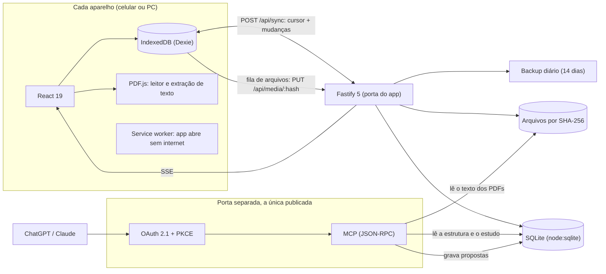

# Arquitetura do LIFE RPG

[English](ARCHITECTURE.en.md) · [README](README.md)

Este documento explica como o LIFE RPG guarda, sincroniza e expõe os dados, e por que cada decisão foi tomada. O app
é de uma pessoa só, mas roda em mais de um aparelho (celular e PC) e conversa com assistentes de IA de fora, então os
problemas são os de um sistema distribuído pequeno: aparelhos sem internet, conflitos, arquivos grandes e uma fronteira
clara do que pode sair de casa.

## Visão geral

O código é um monorepo TypeScript:

- `packages/shared`: as regras de domínio, sem depender de navegador nem de servidor;
- `apps/web`: a PWA (telas, banco local, sincronização, leitor de PDF);
- `apps/server`: a API (sincronização, arquivos, backups, notificações e o conector dos assistentes).

## 1. Dados primeiro no aparelho e sincronização

- **Toda escrita vai primeiro para o IndexedDB.** A interface nunca espera a rede, e o app funciona com o servidor
  desligado. Cada registro carrega `updatedAt` e `deleted` (exclusão lógica), e toda escrita passa por um único módulo
  (`repo.ts`), que atualiza esses campos.
- **Sincronização por cursor.** O servidor mantém um número de revisão global. Cada rodada envia as mudanças do
  aparelho e recebe tudo o que mudou desde o cursor dele. A rodada acontece ao abrir o app, ao voltar para a tela, a
  cada minuto e quando a rede volta.
- **Conflito: vence a alteração mais recente** (*last-write-wins* por registro). É simples e suficiente para uma
  pessoa, mas uma escrita frequente pode desfazer uma mudança feita em outro aparelho. Por isso, dados que mudam o
  tempo todo ficam em registros próprios: a página onde parei num PDF fica num registro de progresso separado do
  registro do PDF, para que ler no celular nunca desfaça uma mudança de disciplina feita no PC.
- **Tabelas só de inclusão** (revisões de cards, pesagens) nunca são editadas, só criadas ou apagadas.
- **Recuperação depois de restaurar um backup.** Se o aparelho conhece revisões que o servidor não tem, o banco do
  servidor voltou no tempo: o aparelho recomeça do zero e reenvia tudo.
- **Quase tempo real.** Quando entra uma revisão nova, o servidor avisa os outros aparelhos por Server-Sent Events.

## 2. Arquivos sem perda

- **Endereçados pelo conteúdo.** Imagens, áudios, PDFs e o texto extraído dos PDFs são guardados pelo SHA-256. O
  servidor confere o hash e o tipo pelos primeiros bytes, com limite por tipo (PDF até 50 MB, texto extraído até 4 MB).
- **Fila de envio persistente.** Os arquivos sobem antes dos registros que os citam, para que outro aparelho nunca
  receba uma nota sem o arquivo dela. Arquivos grandes sobem depois dos registros, para não segurar a sincronização, e
  voltam para o fim da fila se a rede cair.
- **Download sob demanda.** Imagens e áudios de cards baixam em segundo plano (as revisões funcionam offline). PDFs só
  baixam quando são abertos, para não encher o celular, e o texto extraído nunca é baixado pelos aparelhos.
- **Nunca apagar a única cópia.** "Tirar deste aparelho" só apaga a cópia local depois que o servidor responde que tem
  o arquivo (um `HEAD` no endereço dele). Se o servidor responde que não tem, o arquivo volta para a fila de envio.
- **Backup diário** com 14 dias de retenção; os arquivos são espelhados com *hard links*, sem ocupar espaço extra.

## 3. Uma API para assistentes de IA

O ChatGPT e o Claude só alcançam servidores públicos com HTTPS. Em vez de expor o app, o servidor abre uma segunda
porta que serve só o login e o conector, e só ela é publicada (o app e a sincronização continuam na rede privada).

- **MCP sem SDK.** JSON-RPC sobre Streamable HTTP, sem estado, implementado no próprio servidor para não trazer
  dependências novas. Ferramentas: `ler_contexto`, `ler_disciplina`, `ler_apostila`, `ler_material` e
  `enviar_proposta`.
- **OAuth 2.1.** Registro dinâmico de clientes, PKCE com S256, uma página de consentimento que pede o código de acesso
  do app (o código nunca chega ao assistente), chaves de acesso curtas e chaves de renovação que mudam a cada uso.
  O servidor guarda só o hash das chaves, e cada assistente conectado pode ser revogado.
- **A IA nunca escreve direto.** `enviar_proposta` recebe uma proposta (rotina, objetivos, treino, estudo de uma
  disciplina), que é validada contra um JSON Schema e por regras do domínio. Problemas voltam ao assistente como uma
  lista em português para ele corrigir. A proposta válida fica pendente até eu revisar no app: cada item pode ser
  desmarcado, o que já existe com o mesmo nome é reaproveitado e o que não cabe mais é pulado com o motivo.
- **O mesmo formato sem conector.** O app gera um pedido com o contexto e o schema para colar em qualquer chat, e a
  resposta colada passa pela mesma validação.
- **Limites:** 60 chamadas por hora e 10 propostas por dia por assistente, no máximo 3 propostas esperando e 256 KB por
  proposta. O login aceita 5 tentativas por minuto e bloqueia por uma hora depois de 20 erros.

### Fronteira de privacidade

O assistente lê o perfil, a estrutura do app (áreas, rotina, jornadas, objetivos, missões abertas, treino), um resumo
em números das últimas quatro semanas e o estudo das disciplinas: o caderno, as apostilas, os assuntos, as avaliações,
os cards dos baralhos ligados a disciplinas e o texto dos PDFs delas. Nunca lê diário, sono, nutrição, check-ins,
registros de energia, estratégias, baralhos fora das disciplinas nem PDFs sem disciplina. O contexto é montado campo a
campo por uma função pura, e há testes que verificam o que fica de fora.

## 4. PDFs legíveis pela IA

- O PDF é aberto no aparelho com o PDF.js (versão *legacy*, que funciona a partir do iOS 17.4), carregado só quando é
  usado, para não pesar no restante do app.
- Ao adicionar um PDF, o app conta as páginas e extrai o texto de cada uma num arquivo JSON à parte, com uma assinatura
  própria no começo. Se o texto passar de 4 MB, as últimas páginas ficam de fora e a ferramenta avisa.
- O servidor não roda o PDF.js. `ler_material` lê o texto pelo hash, devolve as páginas pedidas até 40 mil caracteres e
  diz de que página continuar. PDFs escaneados sem texto respondem que são imagens.
- No leitor, criar um card de um trecho guarda a página de origem, e a revisão oferece "Ver no PDF".

## 5. Regras de domínio e testes

- `packages/shared` concentra o agendador do dia, XP, recorrência, FSRS, padrões, o parser de captura em português, a
  validação das propostas, o contexto dos assistentes, o cálculo da nutrição e o merge da sincronização.
- Cerca de 2.700 testes com Vitest: as regras puras, as telas com Testing Library e jsdom, o banco local com
  fake-indexeddb e as rotas do servidor (incluindo o fluxo OAuth e o MCP). Eles rodam no GitHub Actions a cada envio.
- O Markdown escrito pelos assistentes (apostilas, caderno) é renderizado por um parser próprio que nunca executa HTML;
  só links `http(s)` viram links, abertos em outra aba.

## Decisões e trade-offs

| Decisão | Alternativa | Por quê |
|---|---|---|
| Vence a alteração mais recente, por registro | CRDT | Um usuário, poucos conflitos reais. Os dados de alta frequência ficam em registros próprios para não colidir. |
| SQLite nativo do Node | PostgreSQL | Um processo, um arquivo, backup simples e nenhuma dependência para instalar no servidor de casa. |
| MCP e OAuth implementados à mão | SDK do MCP | Poucas ferramentas, controle total do que entra e sai, nenhuma dependência nova. |
| Propostas revisadas em vez de escrita direta | Deixar a IA gravar | Nada muda sem revisão; erros da IA viram itens desmarcados, não dados estragados. |
| Texto do PDF extraído no aparelho | Extrair no servidor | O servidor continua leve e sem PDF.js; o texto vai junto com o arquivo na mesma fila. |
| Parser de Markdown próprio | Biblioteca com HTML | O texto vem de fora (assistentes); sem HTML não há injeção de script. |
