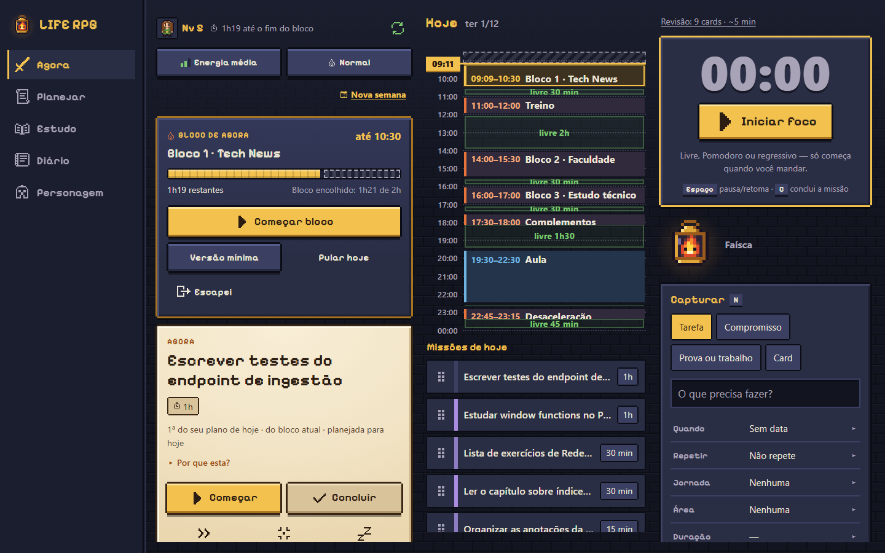
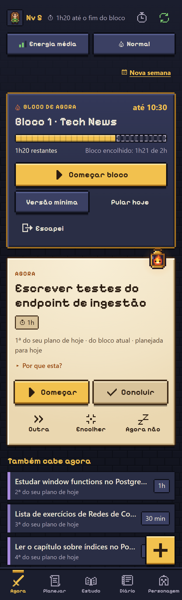
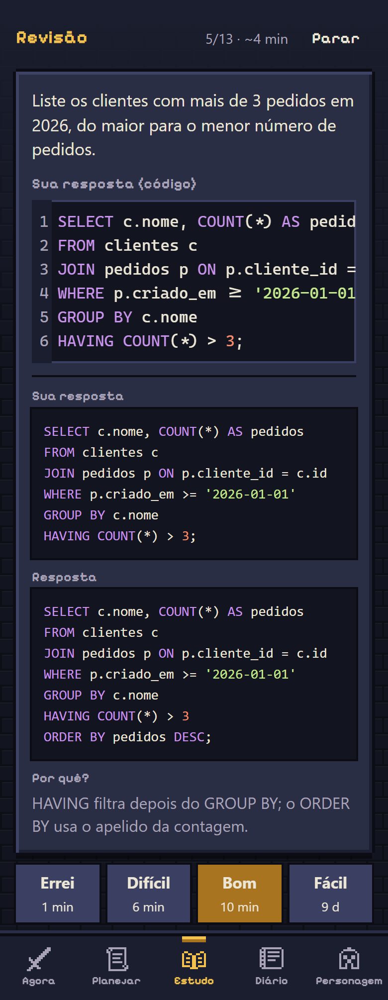
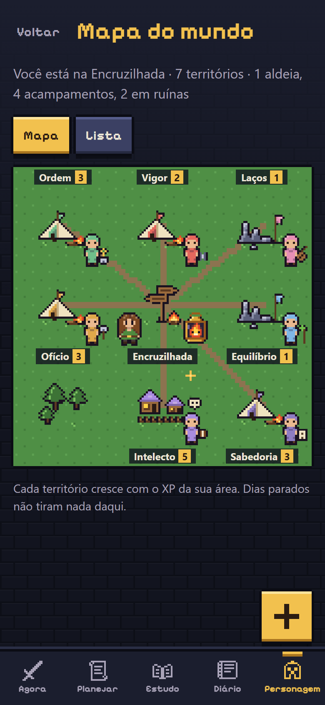
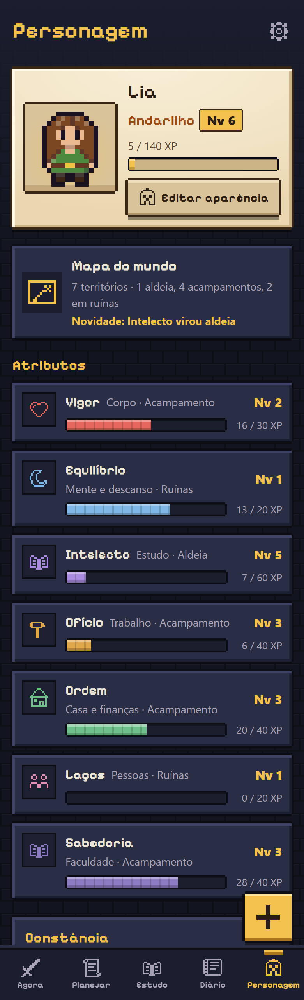

# LIFE RPG


A pixel-art app that turns routine and study into a game, built to help on the hard days.
It is an installable, offline-first web app (PWA), built for a single person: me.

**[Versão em português](README.md)** · [Architecture](ARCHITECTURE.en.md) · [User guide (pt-BR)](docs/guia-de-uso.md)

<p align="center">
  
</p>

<table>
  <tr>
    <td align="center" valign="top" width="25%"><br><sub>Now</sub></td>
    <td align="center" valign="top" width="25%"><br><sub>Code card review</sub></td>
    <td align="center" valign="top" width="25%"><br><sub>World map</sub></td>
    <td align="center" valign="top" width="25%"><br><sub>Character</sub></td>
  </tr>
</table>

<sub>Screenshots taken with fictional data. The UI is in Brazilian Portuguese.</sub>

## In short

- **The problem:** I know what I need to do, but I get stuck when it is time to start, especially on low-energy days.
- **What it does:** shows one quest at a time, adapts to the kind of day, and brings routine, spaced-repetition study,
  training and home into a game where nothing resets.
- **The engineering:** a TypeScript monorepo with data stored on the device first, sync between devices, an MCP
  connector that lets ChatGPT and Claude propose changes that I review, and college PDFs that the AI reads page by page.
- **Quality:** about 2,700 automated tests, with the domain rules in a pure package.

## Why it exists

Often I know what I need to do, but I get stuck when it is time to start. Long lists overwhelm, rigid plans create guilt
when they fail, and to-do apps record what to do without helping me do it.

LIFE RPG tries to close the gap between knowing and doing:

- it shows **one quest at a time**, with a small first step;
- it adapts to the **kind of day** (normal, low energy, recovery or free) instead of demanding the ideal plan;
- **nothing resets, nothing decays, nothing turns red**: a day off does not erase progress;
- its rules were compared with a research base on habits and learning, **separating what was observed from what is a
  hypothesis**.

## What it does

| Area | What it has |
|---|---|
| **Now** | One quest at a time, the day's blocks, kind of day, an optional timer (never required), quick capture with buttons and an end-of-day check-in. |
| **Plan** | Week in blocks, long-term goals, 6 to 8-week seasons, recurring items, commitments, weekly review and one experiment per week. |
| **Study** | Spaced repetition with FSRS-6 and a daily time budget; cloze, code, image and audio cards; "Topic" cards (recall a whole subject without looking); whiteboard; code editor; spoken answers; guided technical practice; oral communication practice. |
| **College subjects** | For each subject: assessments, topics with mastery level, a notebook (syllabus, what was studied, difficulties, bibliography), study handouts and the class PDFs, with a reader that remembers the page, cards made from a passage and "recall before leaving". |
| **Assistants** | ChatGPT or Claude connect over MCP, read how the app is set up and send proposals (routine, goals, training, study for a subject) that I review and apply. It also works without a connector, by copy and paste. |
| **Body and home** | Training with sets, rep ranges, rest and training blocks; sleep in two taps; nutrition with targets and the rest of the day planned from what is at home; menu, shopping list and freezer. |
| **Journal and Patterns** | Journal, planned vs. done, trends, postponements and associations, without treating correlation as causation. |
| **Character and World** | XP and attributes tied to real life areas, a pixel-art map with territories, NPCs and a companion. |
| **Dashboard** | A screen to keep open on a second monitor, updated in near real time when the phone changes something. |

## Engineering

The hardest parts, explained in detail in [ARCHITECTURE.en.md](ARCHITECTURE.en.md):

- **Data on the device first.** Everything is written to IndexedDB and the UI never waits for the network. Devices sync
  through a cursor with a Fastify + SQLite server, resolve conflicts by the latest change, and recover when the server
  database is restored from a backup.
- **Files without loss.** Images, audio and PDFs are stored by content hash and uploaded through a queue. The app only
  removes a device's copy after the server confirms it has the file; if it does not, the file is uploaded again.
- **An API built for AI, with a human in the loop.** The MCP connector was implemented without an SDK: OAuth 2.1 with
  PKCE and dynamic client registration, revocable keys stored only as hashes, hourly and daily limits. The AI never
  writes directly: it sends a proposal that is validated against a schema and only takes effect after my review.
- **An explicit privacy boundary.** The assistant reads the app's structure and the study of college subjects. Journal,
  sleep, nutrition and energy logs never leave the device, and tests make sure of it.
- **PDFs the AI can read.** Each PDF's text is extracted on the device, stored separately and served to the assistant
  page by page, with a size limit and a pointer to where to continue.
- **Pure, tested rules.** The day scheduler, XP, FSRS, patterns, proposal validation and nutrition planning live in
  `packages/shared`, with no browser or server dependency.

## My role

Personal project, from the problem to the infrastructure. I started from a difficulty of my own, defined the game rules
and the behaviour of each feature, chose between the architecture alternatives and their trade-offs, approved the
specifications and checked the deliveries. Much of the code was written with an AI assistant from those
specifications, with automated tests and review at every step.

## Evidence-guided decisions

I compared the app's rules with a research base of 63 sources on habits, learning, sleep and digital interventions.
The [full analysis (pt-BR)](docs/analise-pesquisa-cientifica-2026-11-13.md) links each decision to its sources. Some
changes that came out of it:

- **Logging sleep gives no XP.** Rewarding the logging, not the behaviour, can hurt motivation.
- **An if-then plan on the second postponement**, tied to a block of the day.
- **"Recall before leaving"** after reading a PDF, and "Topic" cards to recall a whole subject without looking.
- **Atypical weeks** (exams, travel) are left out of the comparisons in Patterns.
- **Free timer by default.** Pomodoro is still available but not recommended.
- **XP, levels and the map are treated as personal taste**, not as a proven technique.

## Stack

| Layer | Technologies |
|---|---|
| Web | React 19, Vite 8, vite-plugin-pwa (Workbox), Dexie 4 (IndexedDB), Zustand 5, CodeMirror 6, PDF.js |
| Server | Node 24, Fastify 5, built-in SQLite (`node:sqlite`), Zod 4, web-push, tsup |
| Assistants | MCP (JSON-RPC over Streamable HTTP) and OAuth 2.1, implemented in the server itself |
| Domain | TypeScript, ts-fsrs (FSRS-6) |
| Tests and CI | Vitest, Testing Library, jsdom, fake-indexeddb, GitHub Actions |
| Infra | Multi-stage Docker, docker-compose, Tailscale (HTTPS) |

## Run locally

Requires **Node 24** or newer.

```bash
npm install
npm test                  # all tests
npm run local -- --open   # builds and opens http://localhost:8787
```

Data lives in `data/` (the `life-rpg.sqlite` database, the access token and daily backups), which is not in git. To
sync a browser with the server, go to Personagem → gear → Sincronização and paste the content of `data/token`.
Self-hosting: `docker compose up -d --build`, with HTTPS steps in [deploy/README.md](deploy/README.md).

## Current status

- Personal use: one user, Portuguese-only interface. In use on my PC since November 2026.
- Still to do: tests on a real iPhone (PWA install, notifications, microphone, PDF reader) and the first connection with
  the real ChatGPT and Claude; the connector was tested end to end with a simulated client.
- The in-app AI helpers have not been tested with a real key yet.

## License

[MIT](LICENSE). The pixel art (character, companion, map and icons) is drawn in code, with no third-party packages.
The PDF reader uses Mozilla's PDF.js (Apache-2.0).
