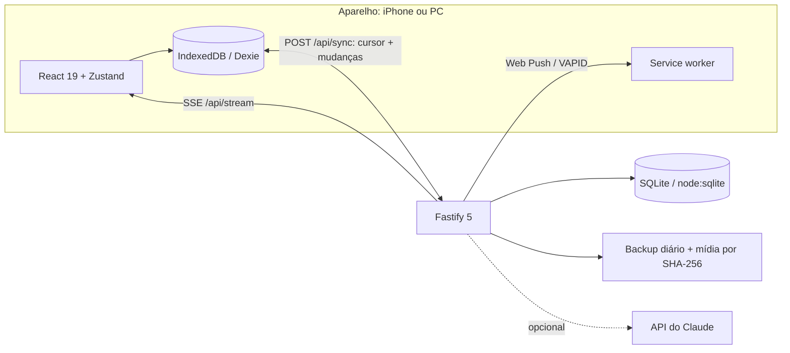

# LIFE RPG

Sistema pessoal de vida, produtividade e aprendizagem com visual de RPG medieval em pixel art.
É um app web instalável (PWA), *offline-first*, feito para uma pessoa só: eu.

<!-- SCREENSHOTS -->

> **English summary.** LIFE RPG is a personal, offline-first PWA for planning the day, studying with
> spaced repetition (FSRS-6) and tracking training, sleep and routines, wrapped in a pixel-art RPG.
> It is a TypeScript monorepo: React 19 + Vite + IndexedDB (Dexie) on the client; Fastify 5 + Node's
> built-in SQLite on the server, with cursor-based sync, Server-Sent Events, Web Push and daily backups;
> deployed with Docker behind Tailscale HTTPS. About 40k lines of TypeScript and ~1,960 automated tests.
> It was built with Claude Code, an AI coding agent: I owned the product vision, requirements, decisions
> and daily use; the agent wrote most of the code under a spec → plan → test-first → review process.
> The UI is in Brazilian Portuguese.

## Por que existe

Muitas vezes eu sei o que preciso fazer, mas travo na hora de começar. Listas longas sobrecarregam,
planos rígidos geram culpa quando falham, e os apps de tarefas registram o que fazer sem ajudar a fazer.

O LIFE RPG tenta diminuir a distância entre saber e fazer:

- mostra **uma missão por vez**, com um primeiro passo pequeno;
- se adapta ao **tipo do dia** (normal, baixa energia, recuperação ou livre) em vez de cobrar o plano ideal;
- **nada zera, nada decai, nada fica vermelho**: um dia parado não apaga o progresso;
- usa ciência do comportamento e da aprendizagem, **separando o que foi observado do que é hipótese**.

## O que ele faz

| Área | O que tem |
|---|---|
| **Agora** | Uma missão por vez, blocos do dia, tipo do dia, cronômetro opcional (nunca obrigatório), captura rápida por botões e encerramento do dia ("Como foi hoje?"). |
| **Planejar** | Semana em blocos, objetivos, itens recorrentes, compromissos, revisão semanal e um experimento por semana. |
| **Estudo** | Revisão espaçada com FSRS-6 e orçamento de tempo diário; cards com lacunas, de código, com imagem e com áudio; cards "Tópico" (lembrar um assunto inteiro sem consultar); lousa com pan e zoom; editor de código com CodeMirror; resposta falada; prática técnica guiada com "reconstruir de novo" (o código fica escondido). |
| **Corpo e casa** | Treino do dia com séries e cargas, sono em dois toques, cardápio, lista de compras, freezer e preparo em lote. |
| **Diário e Padrões** | Diário, planejado × executado, tendências, adiamentos e associações, sem tratar correlação como causa. |
| **Personagem e Mundo** | XP por esforço (não por tempo nem por volume de registro), atributos ligados a áreas reais da vida, mapa em pixel art com territórios, NPCs e um companheiro. |
| **Painel** | Uma tela de leitura rápida para deixar aberta no monitor secundário, atualizada quase em tempo real quando o celular muda algo. |
| **IA opcional** | Pistas graduais na prática técnica, sugestão de cards e resumo da semana pela API do Claude. Fica desligada sem chave, cada ajuda começa desligada e há um teto diário de pedidos. |

O [guia de uso](docs/guia-de-uso.md) explica cada tela.

## Decisões guiadas por evidência

Reuni uma base de 64 fontes científicas (hábitos, aprendizagem, sono, intervenções digitais) e comparei
o app com ela. A [análise completa](docs/analise-pesquisa-cientifica-2026-11-13.md) liga cada decisão às
fontes. Algumas mudanças que saíram dela:

- **Registrar sono não dá XP.** Recompensar o registro, e não o comportamento, pode piorar a motivação.
- **Plano "se-então" no segundo adiamento.** Quando uma missão é adiada de novo, o app propõe uma
  intenção de implementação ligada a um bloco do dia.
- **"Reconstruir de novo" em outro dia** na prática técnica, para medir o que ficou sem ajuda.
- **Semanas atípicas** (provas, viagem) ficam fora das comparações em Padrões.
- **Cronômetro livre por padrão.** O Pomodoro continua disponível, mas não aparece como recomendação.
- **XP, níveis e mapa são assumidos como gosto pessoal**, não como técnica comprovada.

## Arquitetura



- **Offline-first.** Tudo é gravado primeiro no IndexedDB do aparelho. A interface nunca espera a rede, e
  o app funciona com o servidor desligado.
- **Sincronização por cursor.** O servidor mantém um número de revisão global. Cada aparelho envia as
  próprias mudanças e recebe tudo o que mudou desde o seu cursor. Conflitos são resolvidos por
  *last-write-wins* (vence o `updatedAt` mais recente). Se o banco do servidor foi restaurado de um backup
  e o aparelho conhece revisões que ele não tem, o aparelho recomeça do zero e reenvia tudo.
- **Quase tempo real.** Quando entra uma revisão nova, o servidor avisa os outros aparelhos por
  Server-Sent Events. É assim que o Painel do monitor secundário acompanha o celular.
- **Regras de domínio puras.** `packages/shared` concentra agendador do dia, XP, recorrência, FSRS,
  padrões, parser em português e merge, em TypeScript sem dependência de navegador nem de servidor, o que
  deixa essas regras fáceis de testar.
- **Mídia endereçada por conteúdo.** Imagens e áudios são guardados pelo hash SHA-256. O backup diário
  (14 dias de retenção) espelha a mídia com *hard links*, sem ocupar espaço extra.
- **Segurança.** Token de acesso comparado em tempo constante; o servidor escuta só em `127.0.0.1`; o
  acesso remoto passa por HTTPS do Tailscale (`tailscale serve`); a chave da IA fica só no servidor.

## Stack

| Camada | Tecnologias |
|---|---|
| Web | React 19, Vite 8, vite-plugin-pwa (Workbox), Dexie 4 (IndexedDB), Zustand 5, CodeMirror 6 |
| Servidor | Node 24, Fastify 5, SQLite nativo (`node:sqlite`), Zod 4, web-push, tsup |
| Domínio | TypeScript, ts-fsrs (FSRS-6) |
| Testes | Vitest, Testing Library, jsdom, fake-indexeddb |
| Infra | Docker multi-stage, docker-compose, Tailscale (HTTPS) |
| IA (opcional) | SDK da Anthropic, modelo Claude |

```
apps/web         PWA: telas, banco local (Dexie), sync, service worker, pixel art desenhada em código
apps/server      API Fastify: sync, SSE, push, mídia, backups, rotas de IA
packages/shared  regras de domínio puras, compartilhadas pelos dois lados
deploy/          deploy em Docker no servidor de casa, com HTTPS via Tailscale
docs/            guia de uso e análise da pesquisa científica
```

## Números

- Cerca de 40 mil linhas de TypeScript, sem contar os testes.
- 1.961 testes automatizados (Vitest) em 159 arquivos, todos passando.
- Mais de 200 commits entre 11 e 23/11/2026: os 7 marcos da versão 1.0.0 nos três primeiros dias, depois
  ajustes vindos do uso diário.

## Como foi construído

Este projeto foi desenvolvido com o [Claude Code](https://claude.com/claude-code), um agente de IA para
programação. Por isso, todo commit tem o Claude como coautor.

**Minha parte:** a visão do produto, os requisitos a partir da minha rotina real, as prioridades, as
decisões entre as alternativas propostas, o uso diário e o feedback que virou correção. Um exemplo: a
captura rápida usava comandos digitados (`#`, `@`); achei pouco intuitivo e ela virou uma escolha por
botões.

**A parte do agente:** a maior parte do código, das especificações e dos testes, sempre no mesmo processo:

1. conversa de descoberta sobre o problema;
2. especificação escrita do marco, aprovada antes de qualquer código;
3. plano de implementação em tarefas pequenas;
4. implementação com testes escritos primeiro;
5. revisão de código antes do merge.

As especificações e os planos de cada marco existem, mas ficaram fora deste repositório porque descrevem
minha rotina pessoal em detalhe.

## Rodar localmente

Requer **Node 24** ou mais novo.

```bash
npm install
npm test                  # todos os testes
npm run local -- --open   # constrói e abre em http://localhost:8787
```

Para desenvolver com recarga automática:

```bash
npm run dev:server  # API em http://localhost:8787 (dados em ./data)
npm run dev:web     # app em http://localhost:5173
```

- Os dados ficam em `data/` (banco `life-rpg.sqlite`, token de acesso e backups diários). A pasta não vai
  para o git.
- Para sincronizar um navegador com o servidor: Personagem → engrenagem → Sincronização, colando o
  conteúdo de `data/token`.
- O Painel abre em `/painel`.
- No Windows, `LIFE RPG.cmd` faz tudo isso com dois cliques.
- Em servidor próprio: `docker compose up -d --build`. O passo a passo com HTTPS está em
  [deploy/README.md](deploy/README.md).
- IA opcional: defina `ANTHROPIC_API_KEY` no ambiente do servidor. Cada pedido é cobrado na conta da
  Anthropic, com teto diário em `LIFE_RPG_AI_DAILY_LIMIT` (padrão 30).

## Estado atual e limitações

- É um projeto de uso pessoal: um usuário só, interface só em português.
- Ainda faltam testes no iPhone real: instalação como PWA, notificações, microfone e uso offline.
- As ajudas de IA ainda não foram testadas com uma chave real.
- Ainda não há integração contínua (CI) configurada.

## Licença

[MIT](LICENSE). A pixel art (personagem, companheiro, mapa e ícones) foi desenhada no próprio código, sem
pacotes de terceiros.
