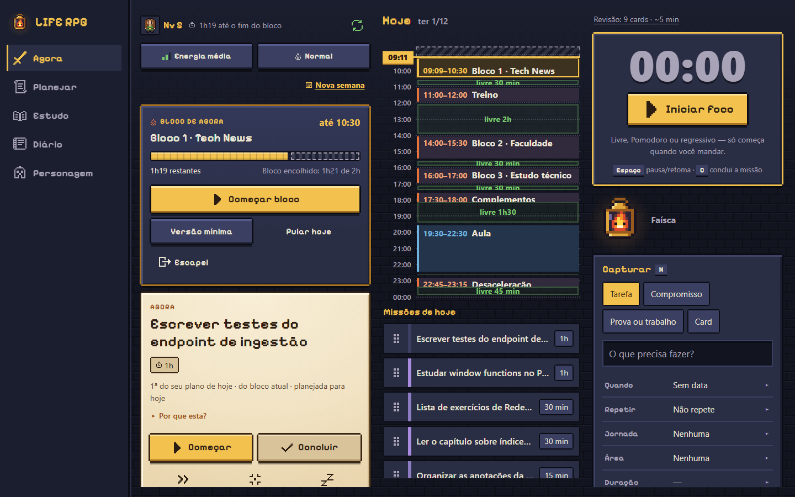
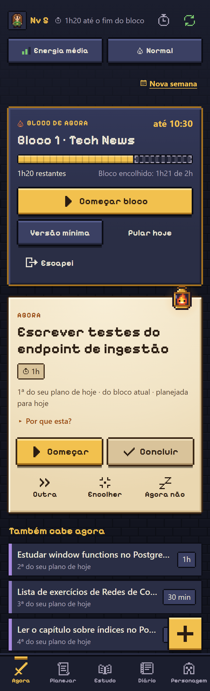
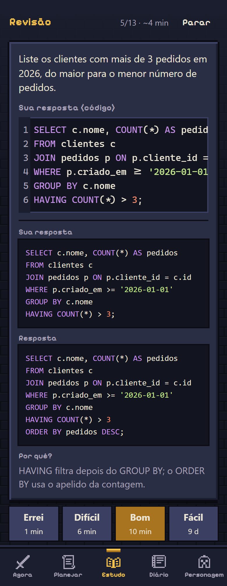
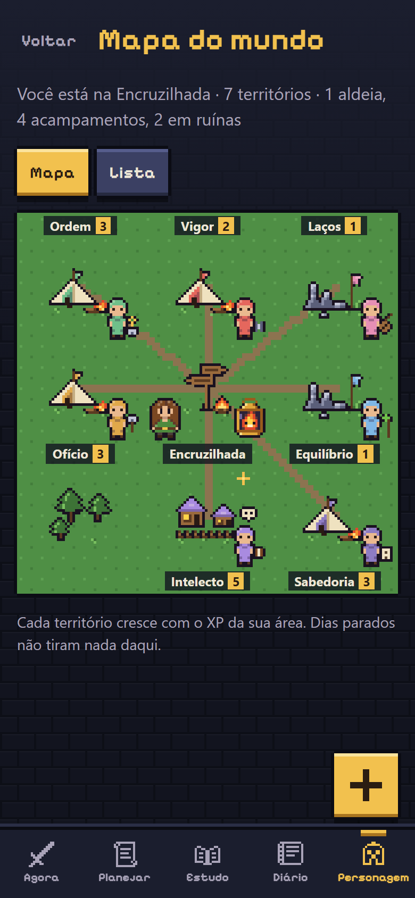
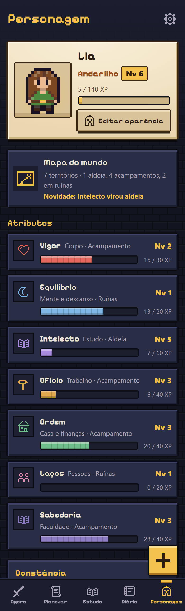
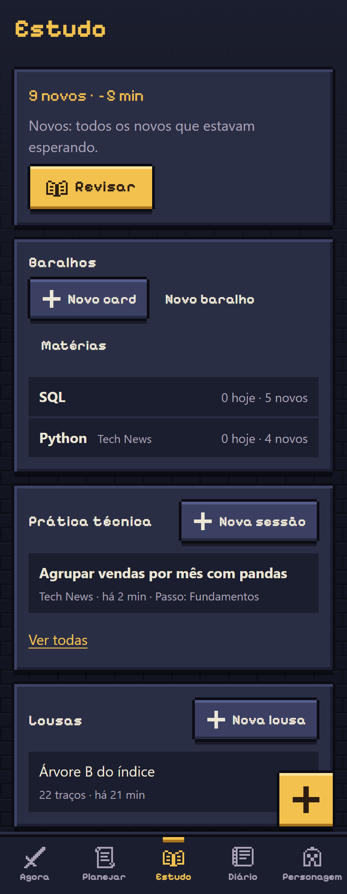
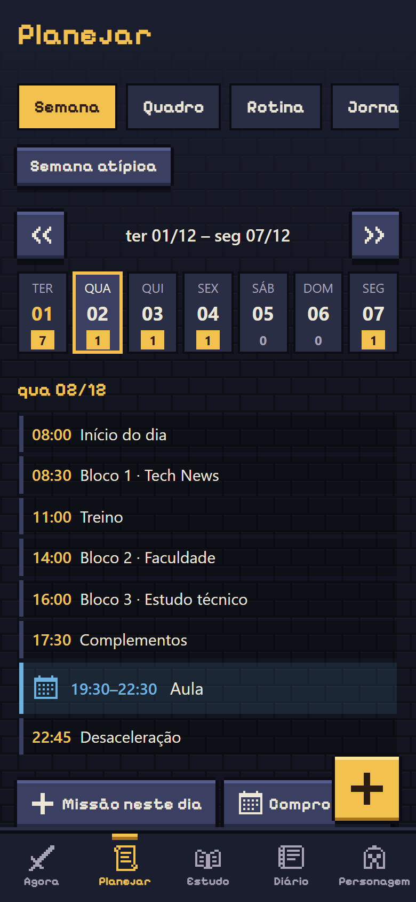
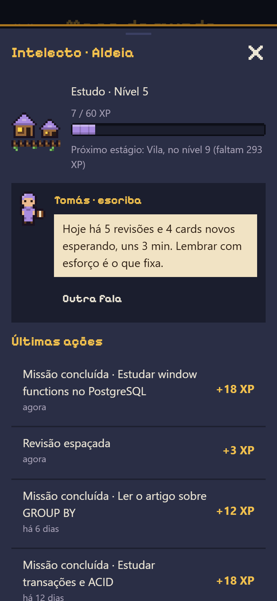

# LIFE RPG


App em pixel art que transforma rotina e estudo num jogo, feito para ajudar nos dias difíceis.
É um app web instalável (PWA), *offline-first*, feito para uma pessoa só: eu.

**[English version](README.en.md)** · [Arquitetura](ARCHITECTURE.md) · [Guia de uso](docs/guia-de-uso.md)

<p align="center">
  
</p>

<table>
  <tr>
    <td align="center" valign="top" width="25%"><br><sub>Agora</sub></td>
    <td align="center" valign="top" width="25%"><br><sub>Revisão de card de código</sub></td>
    <td align="center" valign="top" width="25%"><br><sub>Mapa do mundo</sub></td>
    <td align="center" valign="top" width="25%"><br><sub>Personagem</sub></td>
  </tr>
</table>

<details>
<summary>Mais telas</summary>
<br>
<table>
  <tr>
    <td align="center" valign="top" width="33%"><br><sub>Estudo</sub></td>
    <td align="center" valign="top" width="33%"><br><sub>Semana</sub></td>
    <td align="center" valign="top" width="33%"><br><sub>Território e NPC</sub></td>
  </tr>
</table>
</details>

<sub>Capturas feitas com dados fictícios.</sub>

## Em resumo

- **O problema:** eu sei o que preciso fazer, mas travo na hora de começar, principalmente nos dias com pouca energia.
- **O que ele faz:** mostra uma missão por vez, se adapta ao tipo do dia e junta rotina, estudo com revisão espaçada,
  treino e casa num jogo em que nada zera.
- **A engenharia:** monorepo TypeScript com os dados primeiro no aparelho, sincronização entre aparelhos, um conector
  MCP para o ChatGPT e o Claude proporem mudanças que eu reviso, e PDFs da faculdade lidos pela IA página a página.
- **Qualidade:** cerca de 2.700 testes automatizados, com as regras de domínio num pacote puro.

## Por que existe

Muitas vezes eu sei o que preciso fazer, mas travo na hora de começar. Listas longas sobrecarregam, planos rígidos
geram culpa quando falham, e os apps de tarefas registram o que fazer sem ajudar a fazer.

O LIFE RPG tenta diminuir a distância entre saber e fazer:

- mostra **uma missão por vez**, com um primeiro passo pequeno;
- se adapta ao **tipo do dia** (normal, baixa energia, recuperação ou livre) em vez de cobrar o plano ideal;
- **nada zera, nada decai, nada fica vermelho**: um dia parado não apaga o progresso;
- as regras foram comparadas com uma base de pesquisa sobre hábitos e aprendizagem, **separando o que foi observado
  do que é hipótese**.

## O que ele faz

| Área | O que tem |
|---|---|
| **Agora** | Uma missão por vez, blocos do dia, tipo do dia, cronômetro opcional (nunca obrigatório), captura rápida por botões e encerramento do dia ("Como foi hoje?"). |
| **Planejar** | Semana em blocos, objetivos de longo prazo, temporadas de 6 a 8 semanas, itens recorrentes, compromissos, revisão semanal e um experimento por semana. |
| **Estudo** | Revisão espaçada com FSRS-6 e orçamento de tempo diário; cards com lacunas, de código, com imagem e com áudio; cards "Tópico" (lembrar um assunto inteiro sem consultar); lousa; editor de código; resposta falada; prática técnica guiada; prática de comunicação oral. |
| **Matérias da faculdade** | Para cada disciplina: avaliações, assuntos com nível de domínio, um caderno (plano de ensino, o que já foi estudado, dificuldades, bibliografia), apostilas e os PDFs da aula, com leitor que lembra a página, card criado de um trecho e "lembrar antes de sair". |
| **Assistentes** | O ChatGPT ou o Claude se conectam por MCP, leem como o app está montado e mandam propostas (rotina, objetivos, treino, estudo de uma disciplina) que eu reviso e aplico. Também funciona sem conector, copiando e colando. |
| **Corpo e casa** | Treino com séries, faixas de repetição, descanso e blocos; sono em dois toques; nutrição com metas e o resto do dia calculado a partir do que há em casa; cardápio, lista de compras e freezer. |
| **Diário e Padrões** | Diário, planejado × executado, tendências, adiamentos e associações, sem tratar correlação como causa. |
| **Personagem e Mundo** | XP e atributos ligados a áreas reais da vida, mapa em pixel art com territórios, NPCs e um companheiro. |
| **Painel** | Uma tela para deixar aberta no monitor secundário, atualizada quase em tempo real quando o celular muda algo. |

O [guia de uso](docs/guia-de-uso.md) explica cada tela.

## Engenharia

Os pontos que mais deram trabalho, explicados em detalhe em [ARCHITECTURE.md](ARCHITECTURE.md):

- **Dados primeiro no aparelho.** Tudo é gravado no IndexedDB e a interface nunca espera a rede. Os aparelhos
  sincronizam por cursor com um servidor Fastify + SQLite, resolvem conflitos pela alteração mais recente e se
  recuperam quando o banco do servidor volta de um backup.
- **Arquivos sem perda.** Imagens, áudios e PDFs são guardados pelo hash do conteúdo e sobem por uma fila. O app só
  apaga a cópia de um aparelho depois que o servidor confirma ter o arquivo; se não tiver, envia de novo.
- **Uma API feita para IA, com uma pessoa no meio.** O conector MCP foi implementado sem SDK: OAuth 2.1 com PKCE e
  registro dinâmico, chaves revogáveis guardadas só como hash, limites por hora e por dia. A IA nunca escreve direto:
  manda uma proposta que é validada por schema e só vale depois da minha revisão.
- **Fronteira de privacidade explícita.** O assistente lê a estrutura do app e o estudo das disciplinas. Diário, sono,
  nutrição e registros de energia nunca saem do aparelho, e há testes que garantem isso.
- **PDFs legíveis pela IA.** O texto de cada PDF é extraído no próprio aparelho, guardado à parte e entregue ao
  assistente por página, com limite de tamanho e indicação de onde continuar.
- **Regras puras e testadas.** Agendador do dia, XP, FSRS, padrões, validação das propostas e cálculo de nutrição ficam
  em `packages/shared`, sem depender de navegador nem de servidor.

## Meu papel

Projeto pessoal, do problema à infraestrutura. Eu parti de uma dificuldade minha, defini as regras do jogo e o
comportamento de cada função, decidi entre as alternativas de arquitetura e os trade-offs, aprovei as especificações e
conferi as entregas. Boa parte do código foi escrita com um assistente de IA a partir dessas especificações, com testes
automatizados e revisão em cada etapa.

## Decisões guiadas por evidência

Comparei as regras do app com uma base de pesquisa de 63 fontes sobre hábitos, aprendizagem, sono e intervenções
digitais. A [análise completa](docs/analise-pesquisa-cientifica-2026-11-13.md) liga cada decisão às fontes. Algumas
mudanças que saíram dela:

- **Registrar sono não dá XP.** Recompensar o registro, e não o comportamento, pode piorar a motivação.
- **Plano "se-então" no segundo adiamento.** Quando uma missão é adiada de novo, o app propõe uma intenção de
  implementação ligada a um bloco do dia.
- **"Lembrar antes de sair"** depois de ler um PDF, e cards "Tópico" para lembrar um assunto inteiro sem consultar.
- **Semanas atípicas** (provas, viagem) ficam fora das comparações em Padrões.
- **Cronômetro livre por padrão.** O Pomodoro continua disponível, mas não aparece como recomendação.
- **XP, níveis e mapa são assumidos como gosto pessoal**, não como técnica comprovada.

## Stack

| Camada | Tecnologias |
|---|---|
| Web | React 19, Vite 8, vite-plugin-pwa (Workbox), Dexie 4 (IndexedDB), Zustand 5, CodeMirror 6, PDF.js |
| Servidor | Node 24, Fastify 5, SQLite nativo (`node:sqlite`), Zod 4, web-push, tsup |
| Assistentes | MCP (JSON-RPC por Streamable HTTP) e OAuth 2.1, implementados no próprio servidor |
| Domínio | TypeScript, ts-fsrs (FSRS-6) |
| Testes e CI | Vitest, Testing Library, jsdom, fake-indexeddb, GitHub Actions |
| Infra | Docker multi-stage, docker-compose, Tailscale (HTTPS) |

```
apps/web         PWA: telas, banco local (Dexie), sync, service worker, leitor de PDF, pixel art desenhada em código
apps/server      API Fastify: sync, SSE, push, mídia, backups, IA opcional e o conector MCP com OAuth
packages/shared  regras de domínio puras, compartilhadas pelos dois lados
deploy/          deploy em Docker num servidor de casa, com HTTPS via Tailscale
docs/            guia de uso e análise da pesquisa
```

## Rodar localmente

Requer **Node 24** ou mais novo.

```bash
npm install
npm test                  # todos os testes
npm run local -- --open   # constrói e abre em http://localhost:8787
```

Para desenvolver com recarga automática:

```bash
npm run dev:server  # API em http://localhost:8787 (dados em ./data)
npm run dev:web     # app em http://localhost:5173
```

- Os dados ficam em `data/` (banco `life-rpg.sqlite`, token de acesso e backups diários). A pasta não vai para o git.
- Para sincronizar um navegador com o servidor: Personagem → engrenagem → Sincronização, colando o conteúdo de
  `data/token`.
- O Painel abre em `/painel`. No Windows, `LIFE RPG.cmd` faz tudo isso com dois cliques.
- Em servidor próprio: `docker compose up -d --build`. O passo a passo com HTTPS está em [deploy/README.md](deploy/README.md).
- Assistentes: em Ajustes → Assistentes. O conector precisa de um endereço HTTPS público só para a porta dele (o guia
  mostra como fazer com o Tailscale Funnel); sem ele, use "Sem conector".
- IA opcional dentro do app: defina `ANTHROPIC_API_KEY` no ambiente do servidor. Há um teto diário de pedidos em
  `LIFE_RPG_AI_DAILY_LIMIT` (padrão 30).

## Situação atual

- Projeto de uso pessoal: um usuário só, interface só em português. Em uso no PC desde novembro de 2026.
- Ainda faltam os testes no iPhone real (instalação como PWA, notificações, microfone, leitor de PDF) e a primeira
  conexão com o ChatGPT e o Claude de verdade; o conector foi testado de ponta a ponta com um cliente simulado.
- As ajudas de IA dentro do app ainda não foram testadas com uma chave real.

## Licença

[MIT](LICENSE). A pixel art (personagem, companheiro, mapa e ícones) foi desenhada no próprio código, sem pacotes de
terceiros. O leitor de PDF usa o PDF.js, da Mozilla (Apache-2.0).
